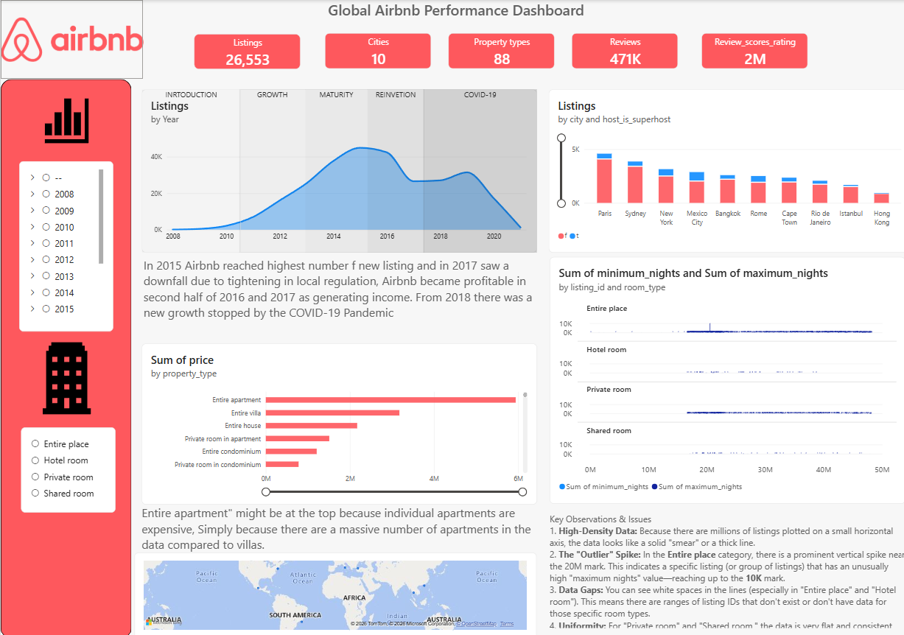

# Power-Bi-Dashboard

# 𝑂𝑣𝑒𝑟𝑣𝑖𝑒𝑤 & 𝐾𝑒𝑦 𝑀𝑒𝑡𝑟𝑖𝑐𝑠🚀 
## I𝑛𝑣𝑒𝑛𝑡𝑜𝑟𝑦 & 𝑅𝑒𝑎𝑐ℎ: 𝑇ℎ𝑒 𝑑𝑎𝑡𝑎𝑠𝑒𝑡 𝑡𝑟𝑎𝑐𝑘𝑠 26,553 𝑎𝑐𝑡𝑖𝑣𝑒 𝑝𝑟𝑜𝑝𝑒𝑟𝑡𝑖𝑒𝑠 𝑠𝑝𝑟𝑒𝑎𝑑 𝑎𝑐𝑟𝑜𝑠𝑠 10 𝑚𝑎𝑗𝑜𝑟 𝑖𝑛𝑡𝑒𝑟𝑛𝑎𝑡𝑖𝑜𝑛𝑎𝑙 ℎ𝑢𝑏𝑠 (𝑖𝑛𝑐𝑙𝑢𝑑𝑖𝑛𝑔 𝑃𝑎𝑟𝑖𝑠, 𝑆𝑦𝑑𝑛𝑒𝑦, 𝑁𝑒𝑤 𝑌𝑜𝑟𝑘, 𝑀𝑒𝑥𝑖𝑐𝑜 𝐶𝑖𝑡𝑦, 𝐵𝑎𝑛𝑔𝑘𝑜𝑘, 𝑅𝑜𝑚𝑒, 𝐶𝑎𝑝𝑒 𝑇𝑜𝑤𝑛, 𝑅𝑖𝑜 𝑑𝑒 𝐽𝑎𝑛𝑒𝑖𝑟𝑜, 𝐼𝑠𝑡𝑎𝑛𝑏𝑢𝑙, 𝑎𝑛𝑑 𝐻𝑜𝑛𝑔 𝐾𝑜𝑛𝑔).

# 𝘈𝘯𝘢𝘭𝘺𝘵𝘪𝘤𝘢𝘭 𝘐𝘯𝘴𝘪𝘨𝘩𝘵𝘴✍️

## • 𝑅𝑎𝑝𝑖𝑑 𝐸𝑥𝑝𝑎𝑛𝑠𝑖𝑜𝑛 (2010–2015): 𝐹𝑜𝑙𝑙𝑜𝑤𝑖𝑛𝑔 𝑎 𝑠𝑙𝑜𝑤 𝑖𝑛𝑡𝑟𝑜𝑑𝑢𝑐𝑡𝑖𝑜𝑛 𝑝ℎ𝑎𝑠𝑒 (2008–2010), 𝑙𝑖𝑠𝑡𝑖𝑛𝑔 𝑎𝑑𝑑𝑖𝑡𝑖𝑜𝑛𝑠 𝑎𝑐𝑐𝑒𝑙𝑒𝑟𝑎𝑡𝑒𝑑 𝑠ℎ𝑎𝑟𝑝𝑙𝑦, 𝑝𝑒𝑎𝑘𝑖𝑛𝑔 𝑖𝑛 2015 (𝑐𝑟𝑜𝑠𝑠𝑖𝑛𝑔 40𝐾 𝑜𝑛 𝑡ℎ𝑒 𝑐𝑢𝑚𝑢𝑙𝑎𝑡𝑖𝑣𝑒/𝑡𝑟𝑒𝑛𝑑 𝑎𝑥𝑖𝑠)
## • 𝑃𝑎𝑛𝑑𝑒𝑚𝑖𝑐 𝐼𝑚𝑝𝑎𝑐𝑡 (2020): 𝐴 𝑚𝑖𝑙𝑑 𝑟𝑒𝑐𝑜𝑣𝑒𝑟𝑦 𝑏𝑒𝑡𝑤𝑒𝑒𝑛 2018 𝑎𝑛𝑑 2019 𝑤𝑎𝑠 𝑎𝑏𝑟𝑢𝑝𝑡𝑙𝑦 ℎ𝑎𝑙𝑡𝑒𝑑 𝑖𝑛 2020, 𝑤𝑖𝑡ℎ 𝑛𝑒𝑤 𝑙𝑖𝑠𝑡𝑖𝑛𝑔 𝑎𝑐𝑡𝑖𝑣𝑖𝑡𝑦 𝑝𝑙𝑢𝑛𝑔𝑖𝑛𝑔 𝑠ℎ𝑎𝑟𝑝𝑙𝑦 𝑑𝑢𝑒 𝑡𝑜 𝐶𝑂𝑉𝐼𝐷-19 𝑡𝑟𝑎𝑣𝑒𝑙 𝑟𝑒𝑠𝑡𝑟𝑖𝑐𝑡𝑖𝑜𝑛𝑠.

